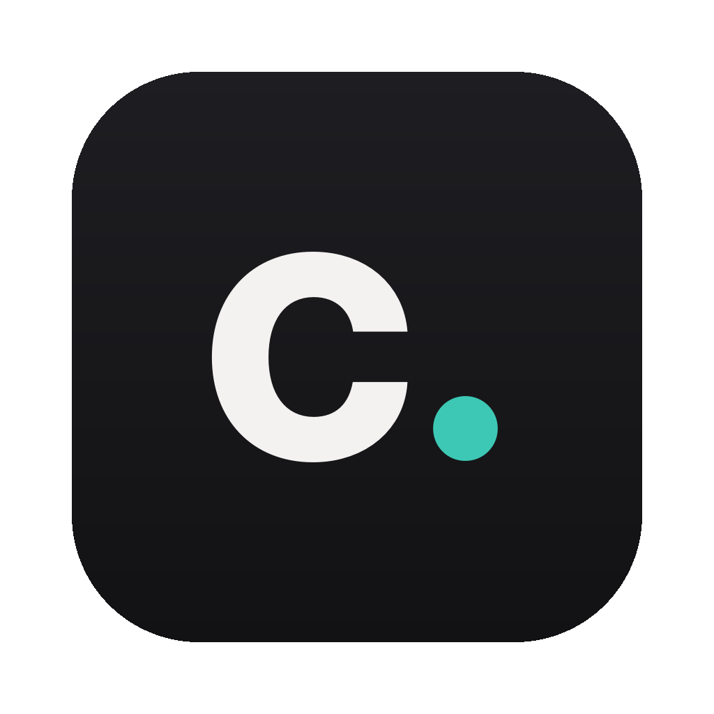
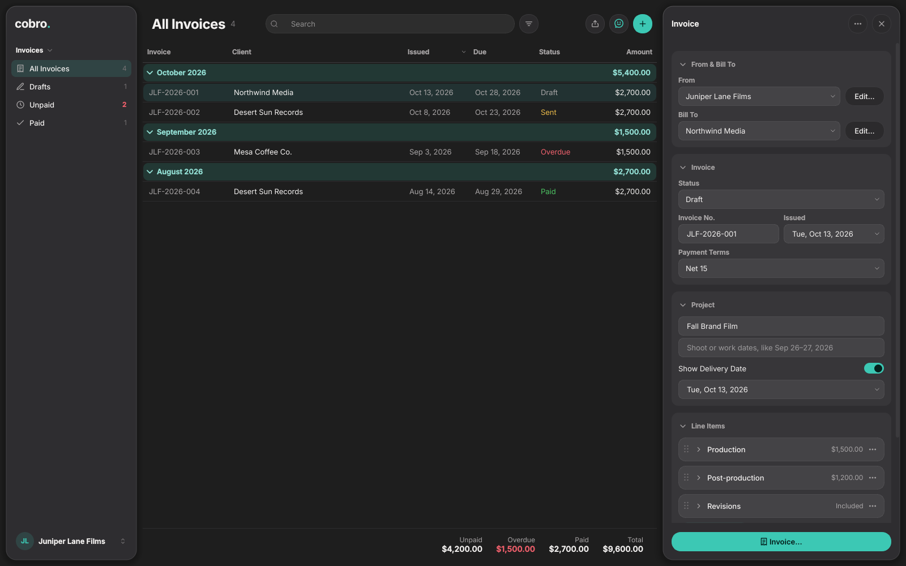

<p align="center"></p>

<h1 align="center">cobro.</h1>
<p align="center"><b>Make an invoice. Send it. Get paid.</b><br>
Clean, good-looking invoices as PDFs, with your logo, your fonts and your colors. Runs on Mac, Windows and Linux.</p>

<p align="center"></p>

---

## Download

Click the one for your computer. These links always give you the newest version.

| Your computer | Download |
|---|---|
| Mac with Apple Silicon (M1 and newer) | **[Cobro for Mac (Apple Silicon)](https://github.com/nickvenecia/cobro/releases/latest/download/Cobro-mac-apple-silicon.dmg)** |
| Intel Mac | **[Cobro for Mac (Intel)](https://github.com/nickvenecia/cobro/releases/latest/download/Cobro-mac-intel.dmg)** |
| Windows | **[Cobro for Windows (installer)](https://github.com/nickvenecia/cobro/releases/latest/download/Cobro-windows-setup.exe)** · [portable .zip](https://github.com/nickvenecia/cobro/releases/latest/download/Cobro-windows-portable.zip) |
| Linux | **[Cobro for Linux (AppImage)](https://github.com/nickvenecia/cobro/releases/latest/download/Cobro-linux-x64.AppImage)** · [.tar.gz](https://github.com/nickvenecia/cobro/releases/latest/download/Cobro-linux-x64.tar.gz) |

Not sure which Mac you have? Apple menu → About This Mac: "Chip: Apple M…" means Apple Silicon. Every version is on the **[Releases page](https://github.com/nickvenecia/cobro/releases)**.

**Installing:**
- **Mac:** open the .dmg and drag Cobro into Applications. The app isn't signed with a paid Apple developer account yet, so the first time macOS says it can't check it: open **System Settings → Privacy & Security**, scroll down and click **Open Anyway**. Only once.
- **Windows:** run the installer (no admin needed). If SmartScreen pops up, click **More info → Run anyway**.
- **Linux:** make the AppImage runnable (right-click → Properties → Allow executing, or `chmod +x`) and double-click it.

Everything comes bundled, fonts included. There's no Python or terminal needed.

**Updates:** Cobro checks for a new version once a day. When there is one, an **Update to …** button appears under the invoice list: it shows what's new, downloads the right file for your computer, swaps it in and reopens Cobro. You can also use **⋯ → Check for Updates…** (or turn the daily check off there).

## What it does

**Fill it in once.** Add your profile the first time you open Cobro: name, logo, address, where checks go, how you like to be paid, your terms. Every new invoice starts with all of it, with the next number already filled in (`RM-2026-001`, `RM-2026-002`…). Save your clients once too (**Bill To → New Client…**), then just pick them: no more typing the same address every time.

**Numbers your way.** One count for all your invoices (`RM-2026-001`), or a separate count for each client with their code in it (`RM-NRTH-2026-001`, or just `NRTH-2026-001`). Pick it under your profile's **Numbers & Tax**.

**Everything on the invoice, in the order it reads:** who it's for, the invoice number and date, payment terms (due on receipt, Net 7 to Net 60), the project with its shoot or work dates and delivery date, line items with details, quantities and rates (a rate of 0 prints as *Included*), discount, sales tax and a deposit already paid.

**Make it look like yours:**
- **Logo** (PNG, JPG or SVG), in three sizes, with or without your name next to it
- **Type styles**: Modern, Clean, Classic, Editorial, **Screenplay** (typed like a script page), Poster and Technical, or pick any two fonts yourself, including fonts installed on your computer
- **Colors**: Ink Blue, Turquoise, Marigold, Oxblood, Sage, Plum, Graphite, or any color you pick
- **Header**: clean, or a full color band
- **Paper**: Letter or A4

The preview on the right is exactly what gets exported, and changes the moment you do.

**Send it out:** **Save PDF…** (fonts embedded, text selectable, small files), **Print…**, **Save as PNG…**, or **Copy as Text** to paste into an email.

**Keep track:** each invoice is a Draft, Sent or Paid (with the date it was paid). Sent invoices past their due date show as **Overdue**. The bottom of the list shows what's still unpaid and what came in this year. Filter the list to see only what's unpaid, overdue, drafts or paid. Right-click an invoice to **duplicate** it for the next job.

**More than one profile?** Add as many as you like (your own name, your production company…) and pick one under **From**. Each has its own details, logo, numbering and look.

**Tidy while you work.** Every part of the details panel folds away and says what's inside. Line items fold to one row each (move, duplicate or remove them from their **⋯** menu). The moon above the preview turns on a **Dark Page** that's easier on the eyes; PDFs and prints always come out on white paper.

**Your data stays yours.** Invoices are saved as small files on your computer only, as you type. Nothing is uploaded. Long invoices flow onto more pages on their own.

## Run from source

```bash
git clone https://github.com/nickvenecia/cobro.git && cd cobro
python3 -m venv .venv && source .venv/bin/activate      # Windows: .venv\Scripts\activate
pip install -r requirements-dev.txt
python -m cobro                    # the app
python -m cobro cli sample out.pdf --header band   # a sample invoice, no window
python -m pytest -q                # tests
```

Build the app yourself: `pyinstaller cobro.spec --noconfirm` → `dist/`.

## Making a release

Builds run on GitHub for every push. To publish downloads:

```bash
# bump __version__ in cobro/__init__.py, then:
git tag v1.0.1 && git push --tags
```

GitHub Actions builds the Mac (Apple Silicon and Intel), Windows and Linux versions, tests each one, and attaches them to a new Release.

### Optional: signing the Mac app
To get rid of the "can't check this app" warning you need an Apple Developer account ($99/yr). Add these repository secrets and the workflow will sign and notarize automatically: `MACOS_CERTIFICATE` (base64 .p12), `MACOS_CERTIFICATE_PWD`, `MACOS_SIGN_IDENTITY`, `APPLE_ID`, `APPLE_TEAM_ID`, `APPLE_APP_PASSWORD`.

## Changing the icon
Run `python scripts/make_icon.py`, or replace `cobro/assets/icon.png` with a 1024×1024 PNG (transparent corners). The Mac and Windows icons are generated from it at build time.

## License
Copyright © Nick Venecia.

Cobro's code is open source under GPL-3.0: you're welcome to read it, learn from it, change it and share it,
as long as what you share stays open source under the same license. The fonts it ships are under the
SIL Open Font License; see [THIRD_PARTY_NOTICES.md](THIRD_PARTY_NOTICES.md).

### Name and icon
The name **Cobro**, the "cobro." wordmark and the app icon are **not** covered by the GPL. They belong to
Nick Venecia and identify the official app. If you publish a modified version, please give it a different
name and icon so people don't mistake it for Cobro. Saying that it's "based on Cobro" is welcome.
